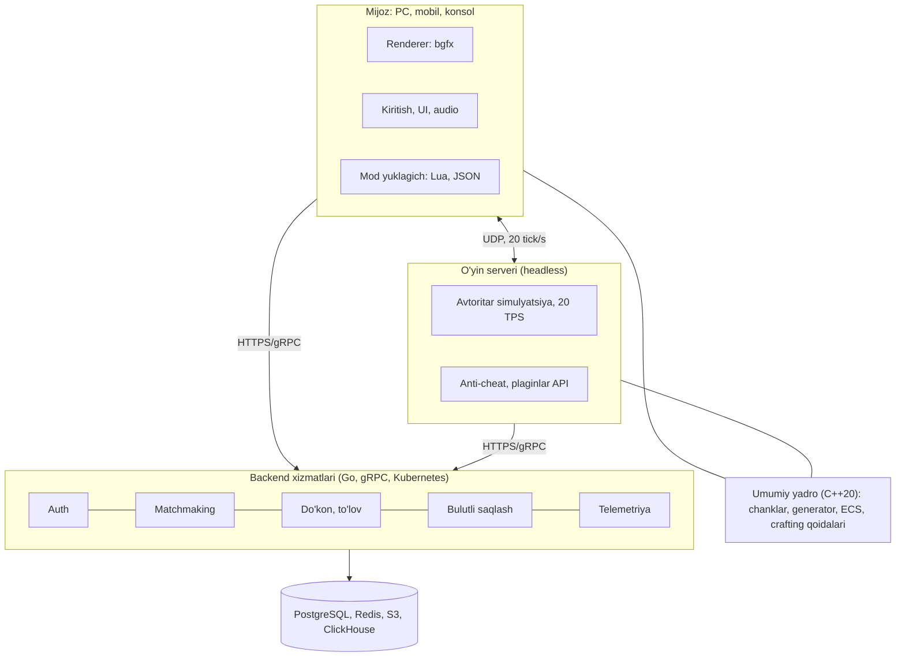

# "Blokland" voksel o'yini — Texnik topshiriq

27-oktabr, 2026 · Akbar Sidikov

> Bu hujjat to'liq o'yin loyihasining rejasi. Repodagi `index.html` — shu rejaning birinchi, brauzerda ishlaydigan mobil prototipi.

## 1. Umumiy ma'lumot va maqsad

"Blokland" (ishchi nom) — ochiq dunyoli voksel (blokli) sandbox o'yini: o'yinchi cheksiz dunyoni o'rganadi, resurs qazadi, narsalar yasaydi, quradi va omon qoladi. Birinchi ommaviy reliz (1.0) loyiha boshlanganidan 18 oy ichida PC uchun chiqadi.

**Maqsadlar:**

- Janrning eng sevimli mexanikalarini (qazish, qurish, crafting, survival) o'z uslubi va dunyosi bilan taqdim etish.
- 12+ yoshli auditoriya va oilaviy o'yin uchun qulay, zo'ravonliksiz uslub.
- Modlar va o'yinchi kontenti uchun ochiq platforma bo'lish.
- Mahalliy bozorni qo'llab-quvvatlash: o'zbek, rus va ingliz tillari birinchi kundan.

**Originallik talabi.** O'yin Minecraft'ning savdo belgilari, nomlari, teksturalari, modellari, ovozlari va kodidan foydalanmaydi. Bloklar, mavjudotlar (moblar), buyumlar va biomlar o'zimizning nomlar va dizaynga ega bo'ladi. Janr mexanikalari (voksel dunyo, crafting) mualliflik huquqi bilan himoyalanmaydi, lekin aniq vizual va audio nusxa ko'chirish taqiqlanadi. Reliz oldidan yuridik tekshiruv (nom, logo, savdo belgisi qidiruvi) majburiy.

**Atamalar:** voksel — 1×1×1 m kub blok; chank — 16×16 ustun, balandligi 384 blok; mob — sun'iy intellektli mavjudot; biom — o'z iqlimi va landshaftiga ega hudud.

## 2. Platformalar va tizim talablari

Birinchi navbatda Windows PC, keyin mobil va konsollar; barcha platformalar bitta kod bazasidan va o'zaro (cross-play) o'ynash imkoniyati bilan.

| Platforma | Bosqich | Minimal talab | Maqsadli FPS |
| --- | --- | --- | --- |
| Windows 10/11 (64-bit) | 1.0 reliz | 4 yadroli CPU, 8 GB RAM, GTX 1050 / RX 560, 4 GB disk | 60 FPS, 1080p |
| Linux, macOS (Apple Silicon) | 1.0 reliz | Windows bilan teng | 60 FPS |
| Android 10+, iOS 15+ | 1.0 dan keyin 6 oy | 4 GB RAM, Adreno 618 / A13 darajasi | 30 FPS (yuqori rejimda 60) |
| Konsollar (Xbox, PlayStation, Switch) | 2-yil | platforma sertifikatsiyasi talablari | 60 FPS (Switch 30) |

- Boshqaruv: klaviatura va sichqoncha, geympad, sensorli ekran.
- Tarqatish: Steam va o'z launcheri (PC), Google Play va App Store (mobil).
- Internet faqat multiplayer, akkaunt va do'kon uchun kerak; bitta o'yinchi rejimi oflayn ishlaydi.

## 3. Asosiy o'yin mexanikasi

O'yin sikli: dunyoni o'rganish → resurs yig'ish → asbob va buyum yasash → qurish va himoyalanish → yangi biom va xavfli hududlarga chiqish.

### 3.1. Voksel dunyo

- Dunyo gorizontal bo'yicha amalda cheksiz (±30 000 000 blok), balandligi 384 blok (−64 dan +320 gacha).
- Dunyo 16×16×16 bo'laklardan (sub-chank) iborat chanklarga bo'linadi; o'yinchi atrofida 8–32 chank radiusi yuklanadi.
- Kamida 120 xil blok 1.0 relizda: tuproq, tosh turlari, rudalar, yog'och, o'simliklar, suyuqliklar (suv, lava), shisha, dekor bloklar.
- Blok xususiyatlari: qattiqlik, qaysi asbob bilan qaziladi, yorug'lik chiqarishi, shaffoflik, tortishish kuchi (qum, shag'al), yonuvchanlik.
- Yorug'lik: quyosh nuri va blok yorug'ligi 0–15 darajada, chank bo'ylab tarqaladi.
- Suyuqliklar oqishi va oddiy fizika (tushish, tortishish).

### 3.2. Protsedural generatsiya

- Dunyo bitta seed (urug' raqam)dan generatsiya qilinadi; bir xil seed doim bir xil dunyo beradi.
- Landshaft: ko'p oktavali Perlin/Simplex shovqini, harorat va namlik xaritalari asosida biomlar.
- 1.0 da kamida 12 biom: o'tloq, o'rmon, qayinzor, cho'l, savanna, tog'lar, qorli tundra, botqoq, okean, daryo, g'orlar, yer osti "kristall g'orlar".
- G'orlar va kanyonlar 3D shovqin bilan, rudalar chuqurlikka qarab taqsimlanadi.
- Inshootlar: qishloqlar, qadimiy xarobalar, yer osti zindonlari, kemalar — o'z dizaynimiz.
- Alohida "boshqa olam" (ikkinchi o'lchov) 1.x yangilanishida.

### 3.3. Qazish va qurish

- Blokni qazish vaqti = blok qattiqligi / asbob kuchi; noto'g'ri asbob bilan buyum tushmaydi.
- Asbob darajalari: yog'och → tosh → mis → temir → "osmontosh" (noyob ruda); har biri chidamlilikka ega.
- Blok qo'yish, aylantirish, yarim bloklar, zinapoyalar, eshik va darvozalar.
- Ijodiy rejimda tezkor qurish asboblari: nusxa olish, to'ldirish, simmetriya.

### 3.4. Crafting va inventar

- Inventar: 36 uyacha + 9 tezkor panel, zirh va qo'shimcha qo'l uyalari.
- Crafting stoli 3×3 to'r, qo'lda 2×2; retseptlar JSON fayllarda saqlanadi va modlar orqali kengaytiriladi.
- O'choq (eritish, pishirish), sehr stoli (buyumlarga xususiyat berish), anvil (ta'mirlash).
- Retseptlar kitobi: ochilgan retseptlar ko'rinadi, yangi o'yinchi uchun yo'l-yo'riq.
- 1.0 da kamida 250 retsept.

### 3.5. O'yin rejimlari

| Rejim | Tavsif |
| --- | --- |
| Omon qolish (Survival) | Sog'liq (20), ochlik, kislorod; buyumlarni o'zi yig'adi; o'lganda inventar tushadi |
| Ijodiy (Creative) | Cheksiz resurs, uchish, o'lmaslik, tezkor qurish asboblari |
| Sarguzasht (Adventure) | Xarita mualliflari uchun: bloklarni faqat ruxsat etilgan asbob bilan buzish mumkin |
| Kuzatuvchi (Spectator) | Devorlar orqali uchish, faqat ko'rish |
| Hardcore | Bitta hayot, o'lganda dunyo faqat kuzatuv rejimiga o'tadi |

Qiyinlik darajalari: tinch, oson, o'rta, qiyin.

### 3.6. Mavjudotlar (moblar)

- Do'stona: qo'y, sigir, tovuq, ot va o'zimizning hayvonlar; ko'paytirish va qo'lga o'rgatish.
- Neytral: hujum qilinsa javob beradi (bo'ri, asalari kabi).
- Dushman: tunda va qorong'i g'orlarda paydo bo'ladi; kamida 8 tur, har biri o'z xatti-harakati bilan.
- Qishloq aholisi: savdo, kasblar, qishloqni himoya qilish.
- Boss: kamida 1 ta yakuniy boss (o'yinning "oxiri" sifatida).
- AI: holat mashinasi yoki behavior tree, A* yo'l topish, paydo bo'lish limitlari (chank bo'yicha).

### 3.7. Kun va tun, ob-havo

- To'liq kun-tun sikli 20 real daqiqa (10 kun, 1,5 kechqurun, 7 tun, 1,5 tong).
- Tunda yorug'lik pasayadi, dushman moblar ko'payadi; to'shakda uxlab tunni o'tkazish mumkin.
- Ob-havo: yomg'ir, momaqaldiroq, qor (biomga qarab).
- Oy fazalari va yulduzli osmon.

### 3.8. Saqlash

- Avtomatik saqlash har 5 daqiqada va chiqishda; chanklar siqilgan region fayllarida (LZ4/Zstd).
- Bulutli saqlash (ixtiyoriy) akkaunt orqali.

## 4. Multiplayer

Multiplayer server-avtoritar modelda quriladi: barcha o'yin mantiqi serverda, mijoz faqat kiritishni yuboradi va natijani ko'rsatadi. Bu cheatlardan himoya qiladi.

- **Rejimlar:** mahalliy tarmoq (LAN), do'stni dunyoga taklif qilish (host), rasmiy va xususiy (o'yinchilar o'rnatadigan) serverlar, pullik bulutdagi shaxsiy dunyo.
- **Sig'im:** bitta server instansiyasida 1.0 da kamida 100 o'yinchi; proxy orqali bir nechta dunyolarni bog'lash.
- **Tarmoq:** UDP asosida ishonchli/ishonchsiz kanallar, 20 tick/s server sikli, mijozda harakat bashorati va interpolyatsiya.
- **Kechikish:** 150 ms gacha ping'da o'yin qulay bo'lishi kerak.
- **Akkaunt:** yagona ID, do'stlar ro'yxati, ovozsiz/ovozli chat (ota-ona nazorati bilan).
- **Moderatsiya:** chat filtri, shikoyat tizimi, ban/kick, server oq ro'yxati, anti-cheat (tezlik, uchish, X-ray tekshiruvlari).
- **Server dasturi:** Linux uchun alohida "headless" server, plaginlar API, sozlamalar fayli.
- **Cross-play:** PC, mobil va konsol o'yinchilari bitta serverda (versiya mos kelsa).

## 5. Texnologiyalar steki va arxitektura

Tavsiya: o'yin yadrosi C++20 da o'zimiz yozgan voksel dvigatel, grafika uchun bgfx (Vulkan, DirectX 12, Metal), backend xizmatlari Go tilida. Mijoz va server bitta umumiy yadro kodini ishlatadi, shuning uchun o'yin qoidalari ikki joyda bir xil.

| Qatlam | Tavsiya | Muqobil |
| --- | --- | --- |
| O'yin yadrosi | C++20, ECS (EnTT) | Unity 6 (C#, DOTS, Burst) |
| Grafika | bgfx: Vulkan / DX12 / Metal / OpenGL ES | Unity URP |
| Fizika va kolliziya | O'z AABB voksel fizikasi | Jolt Physics |
| Audio | FMOD yoki Wwise | OpenAL Soft |
| UI | RmlUi (HTML/CSS ga o'xshash) | Dear ImGui (faqat dev-asboblar) |
| Tarmoq | ENet / GameNetworkingSockets (UDP) | Netcode for GameObjects |
| Modlar | Lua (sol2) skriptlar + JSON ma'lumot paketlari | WebAssembly (Wasmtime) |
| Backend xizmatlari | Go, gRPC, PostgreSQL, Redis | Node.js, NestJS |
| Infratuzilma | Kubernetes, Agones (o'yin serverlari), AWS yoki Hetzner | Nakama, PlayFab |
| CI/CD | GitHub Actions, CMake, Conan | Jenkins |
| Analitika va xatolar | Sentry, ClickHouse + Grafana | GameAnalytics |

**Nega o'z dvigatelimiz:** milliardlab bloklarni samarali chizish, chank generatsiyasi va xotirani to'liq nazorat qilish voksel o'yinda hal qiluvchi. Agar jamoa 8 kishidan kam bo'lsa yoki muddat qisqa bo'lsa, Unity varianti tanlanadi.

### 5.1. Mijoz modullari

- **Dunyo menejeri:** chanklarni yuklash/tushirish, sub-chank bo'yicha saqlash (palitra + bit-packing).
- **Generator:** shovqin, biomlar, inshootlar; ko'p oqimli (job system) ishlaydi.
- **Mesher:** ko'rinmas yuzalarni olib tashlash, greedy meshing, alohida shaffof qatlam.
- **Renderer:** frustum va okklyuziya culling, LOD uzoq chanklar uchun, soya, tuman, suv shaderi.
- **Simulyatsiya:** ECS orqali moblar, fizika, blok tick'lari, suyuqliklar.
- **Kiritish, UI, audio, mod yuklagich, saqlash.**

### 5.2. Server va backend

- **O'yin serveri:** umumiy yadro + tarmoq qatlami, 20 tick/s, headless.
- **Auth xizmati:** akkaunt, OAuth (Google, Apple, Steam), JWT tokenlar.
- **Matchmaking va server ro'yxati, do'stlar, chat.**
- **Do'kon va to'lov xizmati:** buyumlar katalogi, xaridlar, kvitansiya tekshiruvi.
- **Bulutli saqlash:** dunyo fayllari S3 da.
- **Telemetriya:** o'yin hodisalari, crashlar, unumdorlik ko'rsatkichlari.

## 6. Grafika, interfeys va audio

### 6.1. Vizual uslub

- Blokli, lekin o'ziga xos uslub: 32×32 piksel teksturalar (16×16 emas), yumshoq rangli palitra, o'z siluetiga ega moblar.
- Barcha teksturalar, modellar va animatsiyalar jamoa tomonidan noldan yaratiladi; tashqi aktivlar faqat litsenziyasi tekshirilgan holda.
- Grafik sozlamalar: ko'rish masofasi, soyalar, bulutlar, yumshoq yorug'lik, FOV, FPS limiti; ixtiyoriy shaderlar paketi.
- Resurs paketlari (resource packs) qo'llab-quvvatlanadi.

### 6.2. Interfeys (UI/UX)

- Asosiy menyu: Yagona o'yin, Multiplayer, Do'kon, Sozlamalar, Modlar, Chiqish.
- O'yin ichidagi HUD: sog'liq, ochlik, tajriba darajasi, tezkor panel, nishon (crosshair), ixtiyoriy mini-xarita.
- Ekranlar: inventar, crafting, o'choq, sandiq, savdo, xarita, yutuqlar, pauza.
- Mobil versiya uchun alohida sensorli boshqaruv sxemasi.
- Lokalizatsiya: o'zbek (lotin), rus, ingliz — 1.0 da; keyinchalik qozoq, turk va boshqalar. Barcha matnlar tashqi fayllarda.
- Qulaylik: subtitrlar, rang ko'rmaslik rejimlari, tugmalarni qayta sozlash, UI masshtabi.
- Yangi o'yinchi uchun 10 daqiqalik interaktiv o'quv qismi.

### 6.3. Audio

- Original musiqa: kamida 20 ta trek (tinch ambient, biomga qarab).
- Ovoz effektlari: har bir blok materiali uchun qadam, qazish, qo'yish ovozlari; har bir mob uchun alohida ovozlar.
- 3D pozitsion ovoz, g'orlarda aks-sado (reverb).
- Ovoz sozlamalari: musiqa, effektlar, moblar, ob-havo, ovozli chat — alohida balandlik.

## 7. Unumdorlik talablari

Minimal talabdagi PC'da 12 chank ko'rish masofasida barqaror 60 FPS — asosiy unumdorlik mezoni.

| Ko'rsatkich | PC (minimal) | Mobil (minimal) |
| --- | --- | --- |
| O'rtacha FPS | ≥ 60 | ≥ 30 |
| 1% eng past FPS | ≥ 45 | ≥ 24 |
| Ko'rish masofasi (standart) | 12 chank | 6 chank |
| Operativ xotira | ≤ 3 GB | ≤ 1,5 GB |
| Dunyoga kirish vaqti (yangi dunyo) | ≤ 10 s | ≤ 15 s |
| Bitta chank generatsiyasi | ≤ 5 ms (bir oqimda) | ≤ 12 ms |
| Server tick vaqti, 100 o'yinchi | ≤ 50 ms (20 TPS) | — |
| Crashsiz seanslar | ≥ 99,5% | ≥ 99% |
| O'rnatish hajmi | ≤ 4 GB | ≤ 1,5 GB |

- Chank generatsiyasi va meshing asosiy oqimdan tashqarida (job system) bajariladi; kadr vaqtida "qotish" (stutter) 33 ms dan oshmasligi kerak.
- Mobil qurilmada 1 soat o'yindan keyin batareya sarfi ≤ 20%, qurilma qizib FPS tushmasligi uchun termal rejim.
- Har bir build avtomatik benchmark sahnasi bilan tekshiriladi; ko'rsatkich 10% dan ko'p yomonlashsa build "qizil" deb belgilanadi.

## 8. Monetizatsiya

Asosiy model — bir martalik xarid (premium) PC va konsolda, mobilda ham pullik versiya; o'yin ichida faqat kosmetik va kontent xaridlari, "pay-to-win" taqiqlanadi.

| Daromad manbai | Tavsif | Taxminiy narx |
| --- | --- | --- |
| O'yin xaridi | PC / konsol to'liq versiya | $19,99 (O'zbekiston uchun mintaqaviy narx) |
| Mobil versiya | Bir martalik xarid, bepul sinov dunyosi | $6,99 |
| Marketplace | Skinlar, teksturalar paketlari, tayyor xaritalar; mualliflar bilan daromad bo'lishish (masalan 50/50) | $0,99–$9,99 |
| Shaxsiy bulut serverlar | 10 o'yinchigacha doimiy onlayn dunyo, obuna | $3,99 / oy |
| Ta'lim versiyasi | Maktablar uchun litsenziya, dars rejalari | kelishilgan holda |
| Merch va hamkorlik | Litsenziyalangan mahsulotlar (2-yildan) | — |

- 13 yoshgacha bo'lganlar uchun xaridlar faqat ota-ona tasdig'i bilan.
- To'lov tizimlari: Steam, App Store, Google Play, mahalliy to'lovlar uchun Payme / Click integratsiyasi (o'z launcherida).
- Narxlar — taxminiy, bozor tahlilidan keyin aniqlanadi.

## 9. Yo'l xaritasi, jamoa va qabul mezonlari

### 9.1. Yo'l xaritasi

Loyiha 5 bosqichda o'tadi: 1.0 reliz 18-oyda, mobil versiya 24-oyda. Har bir bosqich oxirida "darvoza" (gate) bor: mezon bajarilmasa keyingi bosqichga o'tilmaydi.

| Bosqich | Muddat | Asosiy ishlar | Darvoza |
| --- | --- | --- | --- |
| Prototip | 0–3 oy | Voksel render, generatsiya, qazish va qurish | O'ynaladigan demo |
| Alfa | 4–9 oy | Survival, crafting, 6 biom, moblar, LAN multiplayer | Yopiq alfa testi |
| Beta | 10–15 oy | 12 biom, boss, serverlar, do'kon, 3 til | Steam Early Access |
| 1.0 reliz | 16–18 oy | Optimizatsiya, xatolarni tuzatish, yuridik tekshiruv | 9.3 qabul mezonlari |
| Relizdan keyin | 19–24 oy | Android va iOS, modlar API, konsol portlari | Mobil reliz |

### 9.2. Jamoa

1.0 relizgacha asosiy jamoa 14 kishi; mobil va konsol portlari uchun 2-yilda 4–6 kishi qo'shiladi.

| Rol | Soni | Asosiy vazifa |
| --- | --- | --- |
| Prodyuser / loyiha menejeri | 1 | Reja, muddat, byudjet |
| Geym-dizayner | 2 | Mexanika, balans, kontent |
| Dvigatel dasturchisi (C++) | 3 | Render, chanklar, generatsiya, unumdorlik |
| Gameplay dasturchisi | 2 | Moblar AI, crafting, rejimlar |
| Tarmoq / backend dasturchisi | 2 | Server, multiplayer, xizmatlar |
| 2D/3D rassom, animator | 2 | Teksturalar, modellar, UI grafikasi |
| Kompozitor / ovoz dizayneri | 1 (autsors) | Musiqa, effektlar |
| QA tester | 1 (+ beta hamjamiyati) | Testlash, xato hisobotlari |

### 9.3. Qabul mezonlari (1.0 reliz)

- [ ] Bir xil seed har doim bir xil dunyoni generatsiya qiladi (avtomatik test).
- [ ] 12 biom, 120+ blok, 250+ retsept, 20+ mob turi va 1 boss o'yinda mavjud.
- [ ] Survival, Creative, Adventure, Spectator va Hardcore rejimlari ishlaydi.
- [ ] Kun-tun sikli, ob-havo va moblar paydo bo'lishi texnik topshiriqqa mos.
- [ ] Survival'ni boshidan boss'gacha o'tish mumkin, bloklovchi xatolar yo'q.
- [ ] 100 o'yinchili serverda 20 TPS 1 soatlik yuklama testida saqlanadi.
- [ ] 7-bo'limdagi barcha unumdorlik ko'rsatkichlari minimal qurilmalarda bajariladi.
- [ ] Dunyo saqlanadi va qayta yuklanadi, ma'lumot yo'qolmaydi (kuch o'chishi testi bilan).
- [ ] O'zbek, rus, ingliz tillari to'liq tarjima qilingan.
- [ ] Kritik va yuqori darajadagi xatolar soni 0, o'rta darajali ≤ 20.
- [ ] Yuridik tekshiruv: nom, logo va barcha aktivlar original ekanligi tasdiqlangan.
- [ ] Steam talablaridan o'tilgan, do'kon sahifasi tayyor.

### 9.4. Xavflar

| Xavf | Ehtimol | Choralar |
| --- | --- | --- |
| O'yin Minecraft'ga juda o'xshab ketishi (yuridik va obro' xavfi) | O'rta | O'z vizual uslubi, original aktivlar, reliz oldi yuridik tekshiruv |
| O'z dvigatelini yozish muddatdan cho'zilishi | Yuqori | 3-oyda prototip darvozasi; kechiksa Unity'ga o'tish varianti |
| Mobil qurilmalarda unumdorlik yetmasligi | O'rta | Erta profiling, alohida grafik sozlamalar, LOD |
| Multiplayer'da cheatlar va toksik xulq | Yuqori | Server-avtoritar model, anti-cheat, moderatsiya |
| Bozorda kuchli raqobat | Yuqori | Mahalliy auditoriya, modlar hamjamiyati, o'ziga xos kontent |

### 9.5. Ochiq savollar

- Loyiha byudjeti va moliyalash manbai qancha?
- Yakuniy o'yin nomi va brendi qanday bo'ladi?
- Birinchi relizda mobil versiya kerakmi yoki PC yetarlimi?
